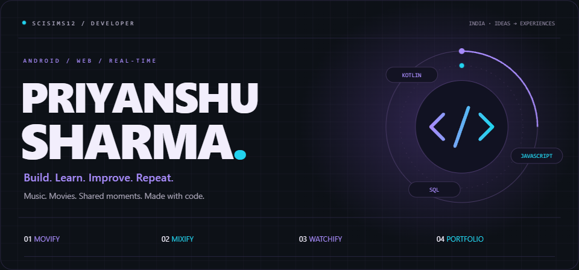
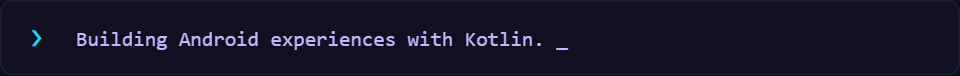
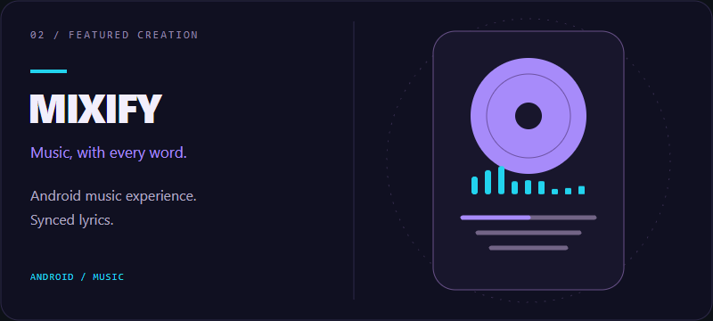
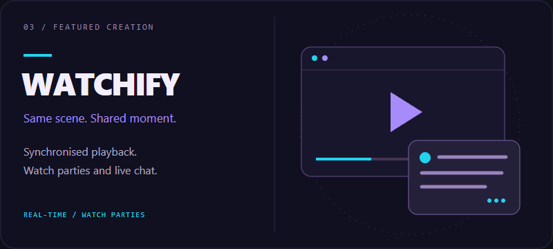
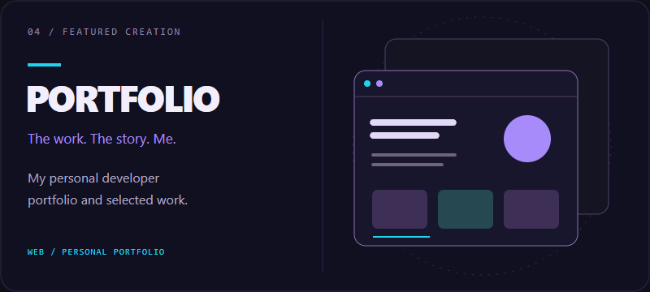
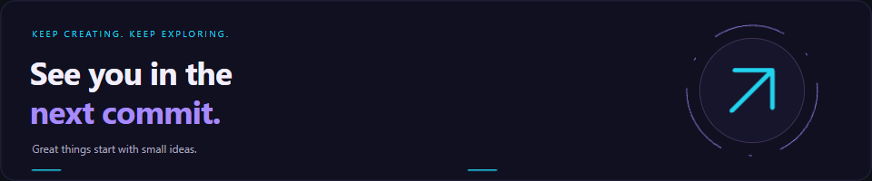

<!-- Upload this README and assets/ to scisims12/scisims12. Setup notes: SETUP.txt. -->

<p align="center">
  <a href="https://portfolio.mixify.co.in/"></a>
</p>

<p align="center"><strong>Android Developer · Web Developer · Creative problem solver</strong><br />Based in India. Building things I want to use.</p>



<p align="center">
  <a href="https://portfolio.mixify.co.in/"><strong>◈ PORTFOLIO</strong></a> &nbsp; / &nbsp;
  <a href="https://github.com/scisims12"><strong>GITHUB ↗</strong></a> &nbsp; / &nbsp;
  <a href="https://www.linkedin.com/in/priyanshu-sharma-a59293241"><strong>LINKEDIN ↗</strong></a> &nbsp; / &nbsp;
  <a href="https://portfolio.mixify.co.in/#contact"><strong>LET'S CONNECT ↗</strong></a>
</p>

<p align="center">
  <a href="#about-me">About</a> &nbsp; · &nbsp; <a href="#currently">Currently</a> &nbsp; · &nbsp;
  <a href="#tech-universe">Stack</a> &nbsp; · &nbsp; <a href="#featured-creations">Projects</a> &nbsp; · &nbsp;
  <a href="#github-activity">Activity</a>
</p>

<p align="center"><sub>This is the still-image edition. <a href="README.md">View the animated README</a>.</sub></p>


## About Me

I’m **Priyanshu Sharma** — an Android and web developer who loves turning creative ideas into useful, thoughtful digital experiences. My projects bring together **music, movies and real-time connections**.

```javascript
const priyanshu = {
  name: "Priyanshu Sharma",
  username: "scisims12",
  location: "India",
  roles: ["Android Developer", "Web Developer"],
  languages: ["Kotlin", "JavaScript", "SQL"],
  interests: [
    "Android applications",
    "Web development",
    "Real-time experiences",
    "Beautiful user interfaces"
  ],
  projects: ["Movify", "Mixify", "Watchify"],
  philosophy: "Build. Learn. Improve. Repeat."
};
```

## Currently

| On my radar | What I'm doing |
| :--- | :--- |
| **🔨 Building** | **Watchify** — real-time watch parties. |
| **📖 Learning** | Jetpack Compose and Kotlin Coroutines. |
| **💬 Ask me about** | Android, Firebase and WebSockets. |
| **⚡ Outside the syntax** | Mere projects mein music aur movies dono hain. 🎵🎬 |


## Tech Universe

| Layer | My tools |
| :--- | :--- |
| **Languages** | Kotlin · Java · JavaScript · SQL |
| **Android** | Android Studio · Jetpack Compose · Kotlin Coroutines · Gradle |
| **Web** | HTML · CSS · JavaScript · Node.js |
| **Data & real time** | MySQL · Firebase · WebSockets |
| **Everyday tools** | Git · GitHub · VS Code |

> Clean interfaces. Thoughtful interactions. Useful experiences. Always learning.


## Featured Creations

### 01 / Movify

[](https://github.com/scisims12/Movify)

**Find your next watch.** Discover movies, TV series and anime.

**[Explore Movify →](https://github.com/scisims12/Movify)**

### 02 / Mixify

[](https://github.com/MixifyTeam/Mixify)

**Music, with every word.** An Android music experience with synced lyrics.

**[Explore Mixify →](https://github.com/MixifyTeam/Mixify)** &nbsp; · &nbsp; [Visit website](https://mixify.co.in/)

### 03 / Watchify

[](https://github.com/scisims12/watchify)

**Same scene. Shared moment.** Real-time watch parties with synchronised playback and live chat.

**[Explore Watchify →](https://github.com/scisims12/watchify)**

### 04 / Portfolio

[](https://portfolio.mixify.co.in/)

**The work. The story. Me.** My background, skills, selected projects and ways to connect.

**[Visit portfolio →](https://portfolio.mixify.co.in/)** &nbsp; · &nbsp; [View source](https://github.com/scisims12/my-portfolio)

<sub>Project artwork is illustrative; follow the links to explore the actual products.</sub>


## GitHub Activity

**[Explore my repositories](https://github.com/scisims12?tab=repositories)** &nbsp; · &nbsp; **[View contributions](https://github.com/scisims12?tab=overview)**


## Beyond the Code

- 📱 Building Android applications that feel useful and intuitive.
- 🌐 Exploring modern web technologies.
- 🎨 Caring about clean UI and thoughtful UX.
- 🚀 Turning side projects into real experiences.
- 📚 Learning, experimenting and improving along the way.

[](https://www.linkedin.com/in/priyanshu-sharma-a59293241)

<p align="center"><strong>Have an idea, a question, or a project in mind?</strong><br /><a href="https://www.linkedin.com/in/priyanshu-sharma-a59293241">Connect on LinkedIn</a> &nbsp; · &nbsp; <a href="https://portfolio.mixify.co.in/#contact">Send a message</a></p>

<p align="center"><sub>Made with 💜 and countless cups of ☕</sub><br /><a href="#">↑ Back to top</a></p>
