 
Android and web developer from Delhi, India.
I build music, movie and real-time apps, mostly things I want to use myself.
 
[Portfolio](https://portfolio.mixify.co.in/) · [LinkedIn](https://www.linkedin.com/in/priyanshu-sharma-a59293241) · [Contact](https://portfolio.mixify.co.in/#contact)
 
---
 
## Projects
 
| Project | What it is |
| :-- | :-- |
| [**Mixify**](https://github.com/MixifyTeam/Mixify) | Android music app with synced lyrics. [Website](https://mixify.co.in/) |
| [**Movify**](https://github.com/scisims12/Movify) | Discover movies, TV series and anime. |
| [**Watchify**](https://github.com/scisims12/watchify) | Watch parties with synchronised playback and live chat. |
| [**Portfolio**](https://portfolio.mixify.co.in/) | My site. [Source](https://github.com/scisims12/my-portfolio) |
 
## Stack
 
```toml
languages = ["Kotlin", "Java", "JavaScript", "SQL"]
android   = ["Jetpack Compose", "Kotlin Coroutines", "Gradle"]
web       = ["HTML", "CSS", "Node.js"]
data      = ["MySQL", "Firebase", "WebSockets"]
tools     = ["Git", "Android Studio", "VS Code"]
```
 
## Now
 
- Building **Watchify**
- Learning Jetpack Compose and Kotlin Coroutines
- Happy to talk about Android, Firebase and WebSockets
 
